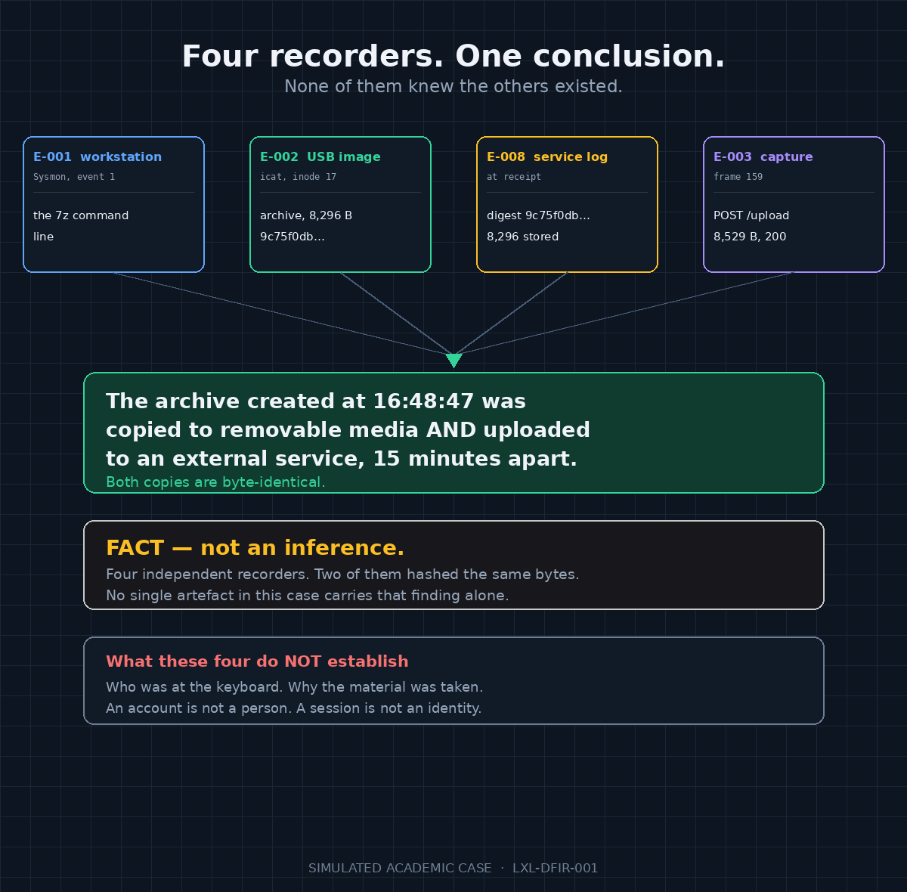
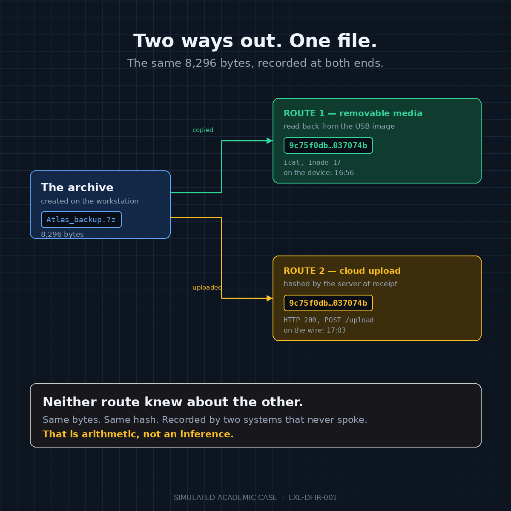
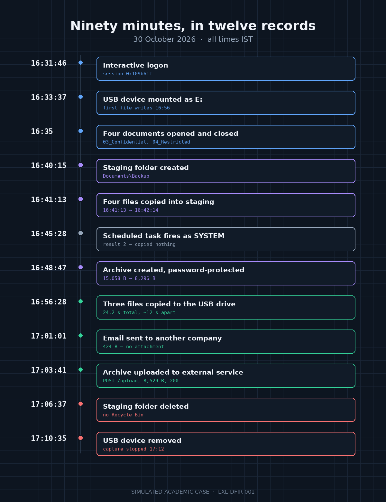
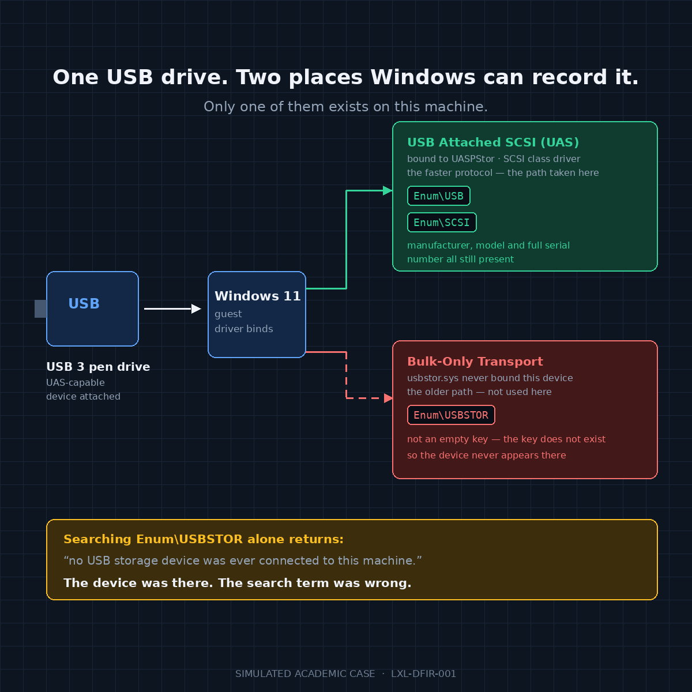

# LXL-DFIR-001 — Corporate Insider Data Transfer

**A simulated, blind digital forensic examination.**

> **On 30 October 2026 a fictional employee of a fictional company copied four confidential files to a USB drive and to a file-sharing service, emailed a colleague at another firm, and deleted his staging folder. I built the environment, ran the incident, sealed the answer key — and then examined the evidence as though I had never seen it.**

---

## What this is

An end-to-end forensic examination of insider data theft, built to test one question:
**can I preserve, examine, correlate and report digital evidence to a defensible
standard?**

It covers a Windows 11 ARM64 endpoint, removable media, email, network traffic and a
cloud service. Every finding is classified as **FACT**, **INFERENCE** or
**UNDETERMINED**, each inference carries a confidence level, and each carries a
stated limitation.

**Everything here is fictional.** No real person, company, credential or data is
involved. All synthetic data is marked as such.

`SIMULATED / ACADEMIC CASE — NOT FOR LEGAL USE`

---



---

## The thing that makes this different

**The answer key was frozen before the examination began.**

19 scripted actions, timestamped by the person who performed them, sealed on
26 October 2026 and not opened until every finding had been written down. Then
compared, in full:

| Outcome across 19 scripted actions | Count |
|---|---|
| Recovered and confirmed | **13** |
| Confirmed, but the recorded time was seconds out | **3** |
| Confirmed, but the *expected artefact* in the plan was wrong | **3** |
| Recorded and left untabulated | **3** |
| Expected artefact cannot exist for this device class | **1** |
| Unexplained | **1** |

**No scripted action failed to occur. Every one of the 19 left evidence.** What the
comparison caught was different: an artefact expectation that is impossible for a
UAS storage device, a Sysmon event type that was never enabled, a human note that
was 4.4 seconds late, and an interval I had misjudged by a factor of five.

→ [`findings/groundtruth_vs_findings.md`](findings/groundtruth_vs_findings.md)

Most portfolio forensic projects present findings as though they were complete.
This one measures its own error rate, because a measured error rate is worth more
than an unmeasured claim — and because the misses are where the learning is.

---

## The finding the whole case turns on

The same 8,296 bytes left the machine by **two routes that had no knowledge of each
other**:

| Route | Record | SHA-256 |
|---|---|---|
| USB device | `icat` from the image, inode 17 | `9c75f0db…037074b` |
| Cloud service | server-side log at receipt | `9c75f0db…037074b` |

The archive was then decrypted and **all four members hash to the four files still
sitting on the workstation**. That is not an inference. It is arithmetic.



### The timeline that reconstruction produced



Twelve records, twelve sources, ninety minutes. Every row in the CSV behind this
image carries a precision (ms / s / min) and the artefact it came from, because a
timeline without provenance is a story.

### And a false negative worth knowing about



The most relied-on USB artefact in Windows returned a clean, confident zero on a
device that was definitely connected. The device was there; the search term was
wrong.

---

## What's inside

| | |
|---|---|
| **The report** | [`report/LXL-DFIR-001_REPORT.docx`](report/) — 11 sections, 18 investigation questions, BSA s.63 analysis |
| **Ground truth vs findings** | [`findings/groundtruth_vs_findings.md`](findings/) — the error-rate measurement |
| **Timeline** | [`findings/timeline_30oct.csv`](findings/) — 27 rows, IST and UTC, with precision and source per row |
| **Evidence register** | [`methodology/evidence_register.md`](methodology/) — exhibits, per-file hashes, retired numbers |
| **Tools** | [`tools/`](tools/) — the two parsers I wrote, with their validation notes |
| **The simulated environment** | [`cloud_service/`](cloud_service/) — the third-party service the subject exfiltrates to. [`tools/smtp_sink.py`](tools/) and [`tools/minimal_imap.py`](tools/) — the mail server that receives the message and the client used to verify delivery |
| **Diagrams** | [`diagrams/`](diagrams/) — five figures, PIL-generated, literal text only |
| **Build log** | [`BUILD_LOG.md`](BUILD_LOG.md) — daily, including what broke |

---

## Three things this project deliberately refuses to do

**1. Attribute activity to a person.** The evidence establishes accounts, sessions,
devices and processes. `artefact → process → session → account → human` terminates
in inference at the last step. The report says so in three separate places rather
than once in a disclaimer.

**2. Treat a tool's label as evidence.** A protocol hierarchy told me there was no
SMTP in a capture that contained a complete SMTP session, because port 2525 is not
in the dissector's default list. **Ports and byte counts are evidence; protocol
labels are inference.** That correction is in the report, not quietly dropped.

**3. Call a screen "verified."** A compose window, a Sent folder and a recipient
field all indicated an email with an attachment. The message was 424 bytes. A
text-only control sent a week earlier was 415. **An artefact is verified by
measurement against a known value, or it is not verified** — and that false
positive is the most instructive thing in the whole case.

---

## Platform and tools

macOS on Apple Silicon · Windows 11 ARM64 under VMware Fusion · a physical USB
device.

The Sleuth Kit · `python-evtx` · `py7zr` · `regipy` · `tshark` · Plaso · 7-Zip ·
two purpose-written parsers for `$UsnJrnl` and for windowed event-log extraction.

**Every tool whose output supports a finding has a known-value test recorded
against it** — see §5 of the report. Version numbers are not validation.

---

## Scope and honesty

This is **targeted collection, not full-disk review**: no unallocated-space, slack
or volume-shadow analysis. **No hardware write-blocker was used** — software
unmounting was the control, and a hash mismatch caused by mounting during imaging
is disclosed in the report rather than tidied away.

The exhibits carry artefacts of simulation, and the report says which ones.

---

## Reproducing it

The environment is not distributed, for the same reason the evidence is not: it is
the case. What is distributed is everything needed to judge the work — the report,
the measurement of its own accuracy, the parsers, and the service that generated
the cloud record.

```bash
git clone https://github.com/PaperHead01/LXL-DFIR-001
cd LXL-DFIR-001
pip install -r requirements.txt
```

---

**Examiner:** Aditya Pandey
**GitHub:** [PaperHead01](https://github.com/PaperHead01)

`SIMULATED / ACADEMIC CASE — NOT FOR LEGAL USE`
